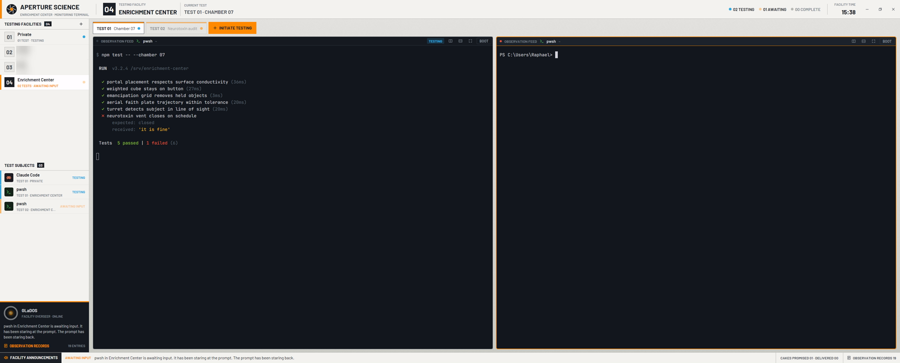

# Aperture Science Enrichment Center for Herdr

A layout for the [Herdr](https://herdr.dev) desktop app that turns it into an
Enrichment Center monitoring terminal. Light facility panels and chamber
signage frame dark monitoring consoles. A facility overseer comments on what
your agents do, in a tone that is mostly professional.



*"Thank you for participating in this test. Your continued usefulness is being evaluated."*

> Unofficial fan work. Not affiliated with or endorsed by Valve. All art,
> sounds and dialogue are original; the fonts are Barlow (SIL OFL 1.1).

## Install

Needs Herdr app 0.1.12 or later and Node 18+.

```sh
node tools/install.mjs          # copies layouts/aperture.json and mods/aperture/ into ~/.config/herdr-app
herdr-app check ~/.config/herdr-app/mods/aperture
herdr-app do layout.switch --name aperture
```

`HERDR_APP_HOME` overrides the target folder. The installer only writes
`layouts/aperture.json` and `mods/aperture/`. `Ctrl+Shift+L` cycles back to
your other layouts. Delete those two paths to uninstall.

## Terminology

| Herdr | Enrichment Center |
|---|---|
| Spaces | Testing Facilities |
| Tabs (sessions) | Tests |
| Agents | Test Subjects |
| New tab / + menu | Initiate Testing |
| Settled tab, brought back | Resume Experiment |
| Close pane / stop | Administer Boot |
| Log | Observation Records |
| Notifications | Facility Announcements |

## What it does

- **Facility header.** The mark, the shown Testing Facility as a chamber
  sign, the current test, live counts (testing / awaiting / complete), the
  facility clock and window buttons. Click the facility for the palette;
  right-click it for Herdr's space menu.
- **Sidebar.** Testing Facilities and Test Subjects with status. A blocked
  subject pulses orange. Below them sits the GLaDOS monitor: an optic that
  breathes faster when someone is waiting, the latest announcement, and the
  Observation Records.
- **Tests bar.** Chamber tabs coloured by status, **Initiate Testing**
  (Herdr's own + menu: a shell or any installed agent), and **Resume
  Experiment** chips for settled tabs.
- **Observation feed headers** on every pane: subject, folder, status, split,
  zoom and **BOOT**.
- **Facility Announcements.** Original GLaDOS lines for: facility online,
  subject acquired, awaiting input, test complete, subject departed, test
  failed (non-zero exit), terminated outside protocol (closed without the
  Boot Protocol), boot administered and boot cancelled. The latest line
  shows in the bottom strip and the monitor. The last 80 lines are kept as
  Observation Records.
- **Cake Protocol.** When a test completes while you weren't looking
  (Herdr's `done`), a cake window appears, searches for the cake, and reports
  a delivery status that is never "delivered". The ledger in the bottom
  strip keeps count.
- **Boot Protocol.** BOOT on a pane header asks first (Enter administers,
  Esc spares). It then plays the kick and closes that pane, which ends its
  terminal; nothing else is touched. Sparing the subject is logged too.
- **Sounds.** A facility chime, subject arrival, relay thunk, failure buzz,
  boot thud and a faint UI tick. All are synthesized (`tools/sounds.mjs`),
  no louder than Herdr's own alerts, and silent when Herdr's sounds are off.

Every action runs a Herdr command or opens Herdr's own menus, so rename,
close, split, worktrees and all keys in `keys.json` work as before.

### Optional keys

The layout's mod takes three commands. Add them to `keys.json` if you want them:

```json
"layout:aperture": {
  "ctrl-shift-r": "aperture.records",
  "ctrl-shift-delete": "aperture.boot"
}
```

`aperture.cake` runs a cake drill. All three also work from a shell:
`herdr-app do aperture.records`.

### Optional themed alert sounds

Herdr's "agent needs you" and "agent finished" sounds belong to
`settings.json`, which applies to every layout. To use the facility's,
set them yourself:

```json
"sounds": { "enabled": true, "done": "mods/aperture/sounds/cake.mp3", "blocked": "mods/aperture/sounds/blocked.mp3" }
```

## Limitations (Herdr 0.1.12)

These are things Herdr's customization system does not expose. They are
documented here rather than worked around.

- **Herdr's own screens keep Herdr's words.** The palette, settings,
  right-click and + menus, rename prompts and Herdr's own "An agent needs
  you" toasts are shipped mods shared by all layouts. Editing them is
  reverted on the next start. They do pick up the console colours.
- **Notifications can't be restyled per layout.** The `toast` mod is global,
  so Facility Announcements live inside the layout instead.
- **Alert sounds are global.** See *Optional themed alert sounds*. The
  layout plays its own sounds only for events Herdr doesn't chime for.
- **No "error" status for mods.** The core's `error` reaches mods as
  `blocked`, so a malfunction is announced as *awaiting input*. A failure is
  recognized by its exit code when the terminal ends. Agents started from
  Herdr's menus run inside your shell, which stays open after the agent
  exits, so their exit code isn't visible; they are announced as departed.
- **Announcements follow redraws.** Events are noticed when Herdr redraws
  the layout. While the window is minimized they wait until it comes back,
  and quick changes in that time can merge (for example, a test that started
  and finished counts as one completion).
- **Ctrl+Shift+X and the menu's Close bypass the Boot Protocol**, on purpose,
  so Herdr's own shortcuts keep working. GLaDOS notices: the departure is
  announced as *terminated outside protocol*.
- **Barlow Condensed doesn't register** as its own family in this version,
  so signage uses Barlow SemiBold and Bold.

## Development

```sh
npm test               # node --test on the pure event engine and lexicon
node tools/art.mjs     # regenerate icons and pictures
node tools/sounds.mjs  # regenerate sounds (needs ffmpeg)
node tools/install.mjs
```

`aperture/` is the shareable layout folder (layout, mod, `RECIPE.md`,
`preview.png`). The agent contract is in `AGENTS.md`.

## License

Code: MIT (see `LICENSE`). Fonts: SIL Open Font License 1.1
(`aperture/mods/aperture/fonts/OFL.txt`).
