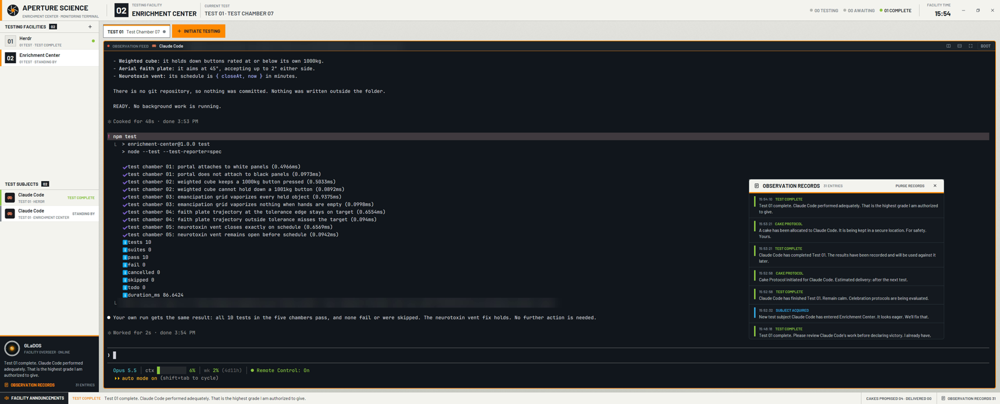

# Aperture

An Enrichment Center monitoring terminal around your terminals. Light grey
facility panels with chamber signage frame dark console panes. Spaces are
Testing Facilities, tabs are Tests and agents are Test Subjects. A facility
overseer announces what the subjects do in dry, passive-aggressive lines. A
test that finishes while you weren't looking triggers the Cake Protocol,
and every pane can be ended through the Boot Protocol.

## What you see

The UI font is Barlow (shipped in `mods/aperture/fonts/`, OFL). Terminals use
JetBrains Mono. Signage is Barlow 600–700 in capitals. Palette: panel
`#f4f4f0`, panel2 `#e7e8e3`, rule `#b7bab5`, ink `#1b2024`, console
`#151b20`, console2 `#1d252b`, orange `#ff8a00`, blue `#2fa8e0`, green
`#8cc63f`, red `#e5533d`.

1. **Header, 60px, full width, window drag.**
   - A 6px orange strip.
   - The mark: a dark disc, six light blade lines and an orange hexagon (34px).
   - `APERTURE SCIENCE` 21px bold, with `ENRICHMENT CENTER · MONITORING TERMINAL` at 10.5px below.
   - A 40px black square holding the shown space's index (`01`, 26px), then
     `TESTING FACILITY` and the space name, then `CURRENT TEST` and `TEST nn · name`.
   - On the right, counts with dots: `nn TESTING` (blue), `nn AWAITING`
     (orange, pulsing), `nn COMPLETE` (green), then `FACILITY TIME` with HH:MM,
     then a 17px gear for `app.settings` (an orange dot when `updates().app.ready`).
   - On Windows and Linux, 42px window buttons (close turns red on hover).
     On macOS, 86px left padding for the traffic lights.
2. **Sidebar, 284px (220–440), panel colour, rule on the right.**
   - `TESTING FACILITIES` with a black count badge and a `+` (new space).
   - Rows of 48px: a 4px orange bar when shown, a 32px number square (black
     when shown), the name, then `nn TESTS · status` (orange when blocked) and a status dot.
   - `TEST SUBJECTS` with a count, then rows of 46px: a 4px status bar, the
     program tile and icon, the session name (else the program name),
     `TEST nn · space` (the program and all of it in the row's tooltip), and the status
     word at the right (`TESTING`, `AWAITING INPUT`, `TEST COMPLETE`, `STANDING BY`).
   - The GLaDOS monitor at the bottom: console colour with a 3px orange top
     border, a 46px optic, `GLaDOS` / `FACILITY OVERSEER · ONLINE`, the
     latest announcement, and `OBSERVATION RECORDS` with the entry count.
3. **Work area, padding 10/12, gap 8.**
   - Tests bar, 38px: chips `TEST nn` plus a name: the tab's own when someone
     named it, else its (focused, else first) agent's session name,
     with a 3px top bar (orange when shown, else the status colour) and a
     status dot. Then an orange `+ INITIATE TESTING` button. Settled tabs show
     at the right as `▶ RESUME EXPERIMENT · name`, then `FILES` and `CHANGES`
     (black when their panel shows; only those listed in shared
     `workspace.panels`, default both). They run `layout.select {stack:
     "panel-body", child}` + `layout.show {id: "panel"}`, or `layout.hide`.
   - The panel: 368px (280–900), radius 6, border `#7d8487`, surface
     colour, hidden at first, holding Herdr's `files` and `changes` mods.
   - Panes: background `#12171b`, radius 6, border `#7d8487` 1px, focus
     orange 2px, gap 10, framed even when alone. Each has a 28px header: a red
     dot pulsing when focused, `OBSERVATION FEED`, the program icon and name,
     the folder, a status pill, split right, split down, zoom (only when the
     tab has more than one pane, or to restore), and `BOOT`.
4. **Footer, 34px.** A black `FACILITY ANNOUNCEMENTS` block (the speaker
   icon pulses for 20s after a new line), the latest tag and line,
   `CAKES PROMISED nn · DELIVERED 00`, and `OBSERVATION RECORDS nn`.

The theme is `graphite` with every colour overridden in the layout's
`colors`, ansi0–15 included. Herdr's own menus and dialogs come out as dark
consoles.

## How it behaves

| Status | Colour | Word |
|---|---|---|
| working | blue | TESTING |
| blocked | orange, pulsing | AWAITING INPUT |
| done | green | TEST COMPLETE |
| idle | grey | STANDING BY |

- **Clicks.** A facility runs `space.select`; a subject runs `agent.focus`; a
  test chip runs `tab.select`. Initiate Testing opens `new-menu`. Resume
  Experiment runs `tab.unsettle` then `tab.select`. The header's facility
  opens `app.palette`. The `+` in the sidebar runs `space.new`.
  OBSERVATION RECORDS opens the records window.
- **Right-clicks** open Herdr's `menu` mod: facility → `space`, chip → `tab`,
  subject and pane header → `pane`, anything else → `global`.
- **Pane header buttons** run `pane.split` right/down, `pane.zoom`, and open the Boot dialog.
- **Announcements.** The footer copy diffs `agents()` on each render (render
  only queues events). A 700ms timer publishes them into shared
  `aperture.log` (the last 80). Events:
  - arrived: a new address.
  - blocked: a change into blocked.
  - completed: working → done/idle; `done` means nobody was looking.
  - departed: the address is gone. After 1.2s, `hc ls --json --all`
    classifies it: booted (marked by the Boot dialog in the last 30s),
    terminated (reason `killed`), failed (non-zero exit), or departed.
  - online: the layout started, at most once per 30 minutes.

  Lines rotate per kind from a random start.
- **Cake Protocol** (completed with `done`): adds to the promised count,
  logs a cake line, and opens a 400×268 window (key `aperture-cake`). It shows
  `LOCATING CAKE…` frames for 3.2s, then a random delivery status. It closes
  after 16s. Its buttons are Resume Experiment (`agent.focus`) and Accept Cake
  (logs a claim; delivered stays 00).
- **Boot Protocol**: a modal 460×300 dialog. Enter administers and Esc
  spares (spare is logged). Administering plays `boot.mp3`. The boot slides
  in (left, 220ms) and the subject plate leaves (left and opacity, 420ms after
  180ms). At 650ms it re-checks that the pane still shows the same terminal,
  sets `aperture.booting[terminal]`, runs `pane.close`, and closes itself.
- **Sounds** (`playSound`, skipped when `settings().sounds.enabled === false`):
  `online`, `arrive`, `thunk` (terminated), `fail`, `boot`, and `tick` (Initiate,
  Resume, Spare).
- **Keys** to the mod (`nextCommand`, footer copy): `records`, `boot` (focused pane), `cake` (drill).

## Built from

- `layouts/aperture.json`: a root column with `titlebar: "none"`,
  `traffic_lights: [18, 22]`, the theme and colours above,
  `ui_font: "Barlow"` and a gradient background `#e4e5e0 → #c9cbc5`.
  - `header` block (px 60, window_drag).
  - `body` row: `sidebar` block (px 284, min 220, max 440) and `work` column
    (resizable false) with `tabs` (px 38) and a `work-body` row (gap 10) of
    `main` (`tab: active` with the pane frame and a header
    `{ mod: aperture, props: { role: pane } }`, 28px, top, always) and the
    hidden `panel` column with the `panel-body` stack (`files`, `changes`).
  - `footer` block (px 34).
- **One mod, `mods/aperture`** (`place: none`), roles from `props().role`:
  `header`, `sidebar`, `tests`, `pane`, `announcements`, `boot`, `cake`, `records`.
  - `kit.js`: palette and helpers.
  - `events.js`, `lexicon.js` and `names.js`: pure, unit-tested.
  - Session names come from each agent's terminal `title` in `agents()`, with
    leading status glyphs stripped; a title equal to the program name is no name.
- **herdr functions:** spaces, agents, panes, run, setAgentOrder, shared,
  setShared, hc, nextCommand, openOverlay, closeOverlay, playSound,
  settings, window, props, home.
- **Shipped mods used:** `menu`, `new-menu`, `files`, `changes`.
- **Programs run:** `hc ls --json --all` (only after a departure).
- **Art and sound:** generated by `tools/art.mjs` and `tools/sounds.mjs` (ffmpeg).

## Watch out

- `line_height(n)` with a bare number is a multiplier; `18` makes text 18 lines tall.
- Barlow Condensed TTFs don't show up in `fonts()`; use Barlow.
- `herdr-app check` only renders the mod without props (the "no role"
  path). Check each role live with `layout.switch` and `herdr-app shot`.
- A minimized window never redraws: `herdr-app shot` returns a stale frame,
  and render-driven event detection pauses until the window is restored.
- The core's `error` status arrives as `blocked`.
- Terminals started with `hc run` from inside an agent become its
  sub-agents; strip `HC_TERMINAL_ID`/`HC_SCOPE` for a top-level test terminal.
- Hot reloading restarts the mod copy, so state that must survive goes in `shared`.

## Done when

1. `npm test` passes, and `herdr-app check ~/.config/herdr-app/mods/aperture` passes.
2. `layout.switch {name: "aperture"}` shows the frame, and `herdr-app status` has `"errors": []`.
3. A terminal sending `ESC]7501;state=working ESC\` then `state=blocked`
   adds a SUBJECT ACQUIRED line, then AWAITING INPUT, and its row pulses orange.
4. working → done while another tab is shown opens the Cake window, and the promised count goes up.
5. BOOT on a pane, then Enter: the pane closes, and the log says BOOT
   ADMINISTERED. Esc instead: nothing closes, and the log says BOOT CANCELLED.
6. `hc run --label herdr.space=<id> --label herdr.tab=x -- <cmd exiting 3>` ends with TEST FAILED.
7. Initiate Testing opens Herdr's + menu, and right-clicks open Herdr's menus.
